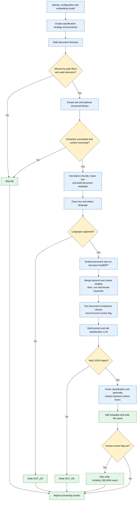

# DocClassify Pipeline Flow

Entry point: [`DocClassify.py`](../../src/Apps/DocClassify.py). The shared
[`LoadAndClassifyProcessor`](../../src/Pipeline/LoadAndClassifyProcessor.py)
extracts each document before [`ClassifyStrategy`](../../src/Strategies/ClassifyStrategy.py)
processes it.

