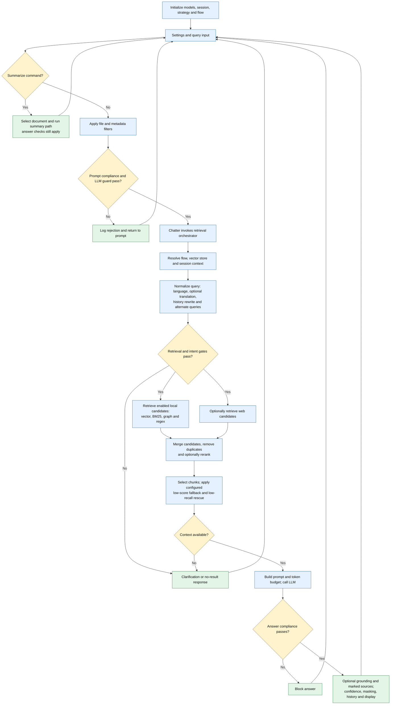

# RAGChat Pipeline Flow

The interactive entry point is [`RAGChat.py`](../../src/Apps/RAGChat.py).
Retrieval is orchestrated by [`Orchestrator.py`](../../src/Orchestrator/Orchestrator.py);
answer generation and post-processing are handled by
[`Chatter.py`](../../src/Chat/Chatter.py). Steps vary by session and flow.

