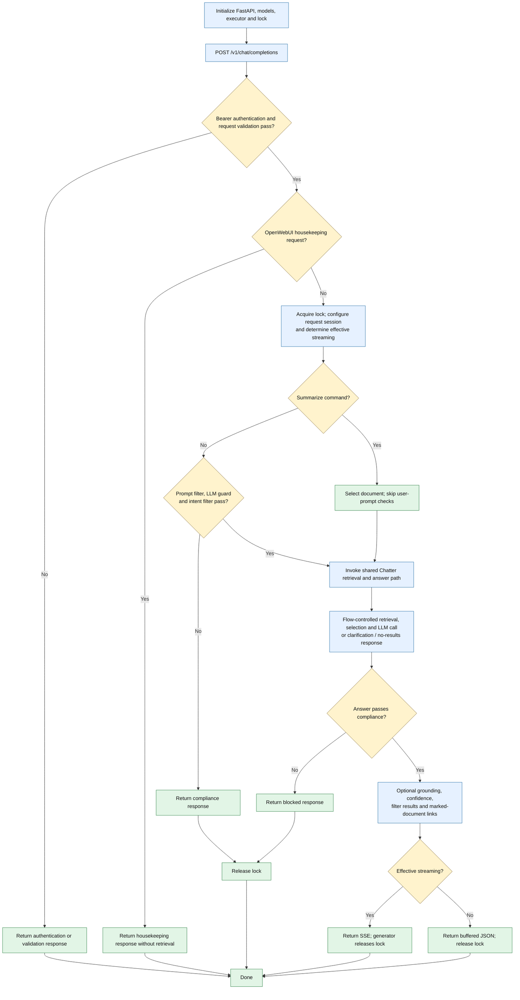

# RAGChatService Pipeline Flow

The service entry point is [`RAGChatService.py`](../../src/Apps/RAGChatService.py).
Request handling and the streaming/buffered branches are in
[`ChatCompletionHandler.py`](../../src/Api/ChatCompletionHandler.py); the
shared answer path is [`Chatter.py`](../../src/Chat/Chatter.py).

When `mark_text` is enabled, requested streaming is downgraded to a buffered
reply. Otherwise, streaming callbacks can send tokens during the LLM call,
before answer compliance has completed. The `/v1/models` and optional
`/marked/{token_filename}` endpoints are separate from the chat-completions
path.
