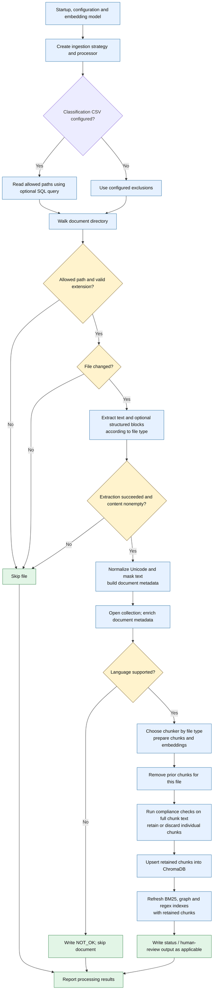

# RAGLoad Pipeline Flow

The processing path depends on configuration and file type. Entry point:
[`RAGLoad.py`](../../src/Apps/RAGLoad.py); per-file processing:
[`LoadAndClassifyProcessor.py`](../../src/Pipeline/LoadAndClassifyProcessor.py) and
[`DocumentIngestionStrategy.py`](../../src/Strategies/DocumentIngestionStrategy.py).

