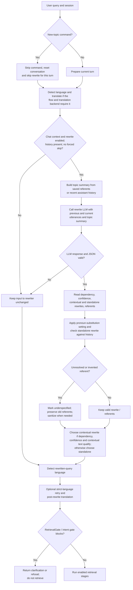

# Query Rewrite - Coreference Resolution Before Retrieval

The flow varies with the selected orchestration profile and session settings.
See [`RAGChatImpl.py`](../../src/Chat/RAGChatImpl.py),
[`PromptRewrite.py`](../../src/Chat/PromptRewrite.py), and
[`RetrievalGate.py`](../../src/Chat/RetrievalGate.py).

