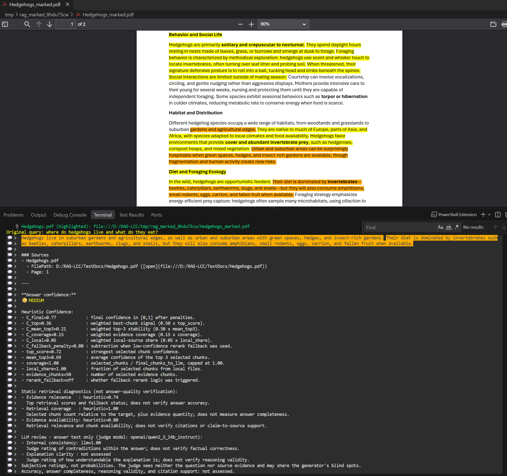
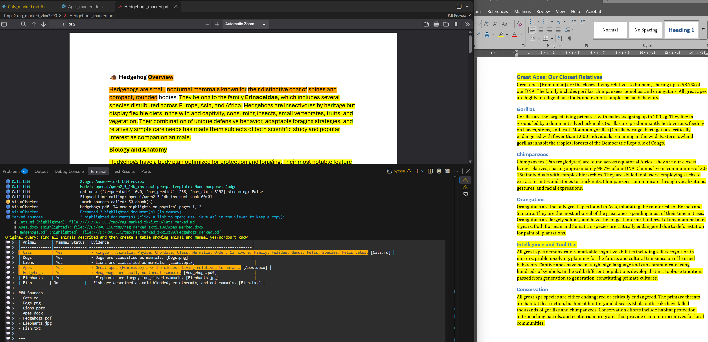
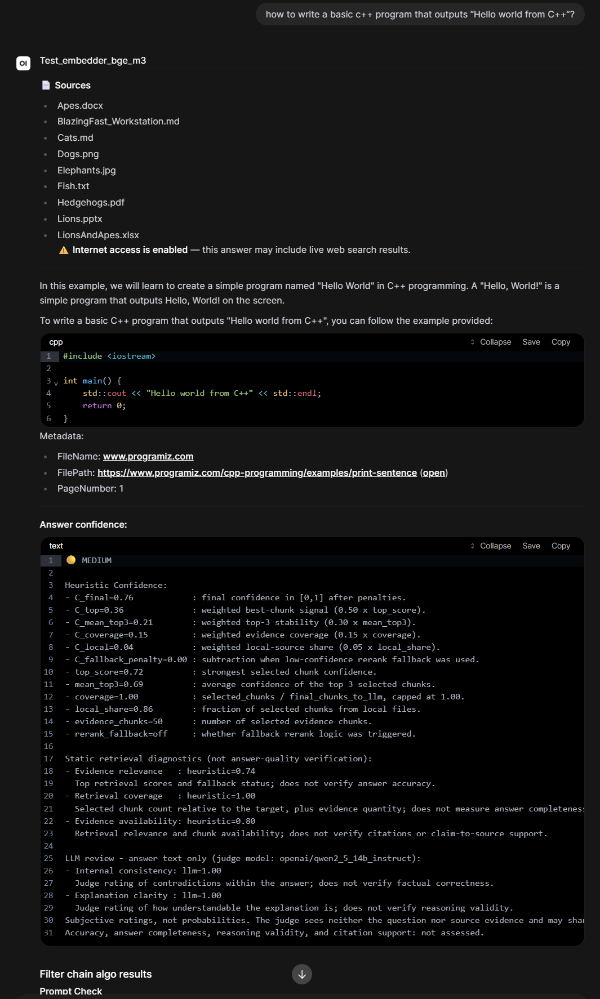

<!-- markdownlint-disable MD033 MD060 -->
# 🧪 RAG‑LCC — Experimental RAG Under Constraints

<p align="center">
  
</p>

<p align="center">
  
</p>

## 🎯 Who this is for

- 🔬 Researchers and practitioners exploring *why* RAG pipelines succeed or fail
- 🧠 Engineers working with **large, multilingual, or conflicting document sets**
- 👩‍🏫 Teachers and students learning RAG internals through hands-on experimentation
- 💬 Anyone debugging **multi‑turn chat‑context failures** in RAG systems
- 💻 Users running RAG on **constrained or commodity hardware**
- 🧪 People who want to experiment beyond "embed + cosine + top‑k" — see [Query Output Example](QUERY_OUTPUT_EXAMPLE.md) for what a full pipeline run looks like

---

**RAG‑LCC is an experimental Retrieval‑Augmented Generation (RAG) lab focused on understanding and controlling retrieval and context assembly under real‑world constraints**: limited context windows, modest GPUs, large documents, multi‑turn chat, and explicit confidence evaluation of retrieval evidence.

- DocClassify       Document classification - results may be used as input filter for RAGLoad
- RAGLoad           Text extraction (document formats, pictures, MS Office) and Vector DB ingestion
- RAGChat           (CLI GUI) and RAGChatService (Open WebUI integration)

<p align="center">

<p>

Instead of pushing ever‑larger context sizes, RAG‑LCC treats **classification, chunking, retrieval strategies, staged loading, and confidence evaluation** as first‑class architectural tools.

---

### Tabular answer with source grounding

A single query can retrieve information and request a table. This example shows an animal classification table alongside highlighted passages in the source documents.



### 📌 OpenWeb UI Example

By clicking on the *Marked Sources* link the grounded answer is displayed.

OpenWebUI grounding example (via `RAGChatService`):



---

## 🧠 What it does — and why it exists

Short: If you want to understand *why* your RAG fails, RAG-LCC gives you a playground to experiment with the parameters that matter. You can tune settings, compare alternatives on a small test corpus, and carry those insights back into your own RAG. You also get explicit confidence metrics per turn (`C_final`, `C_top`, `C_mean_top3`, `C_coverage`, `C_local`, `C_fallback_penalty`), so ingestion and retrieval changes can be evaluated with measurable signals instead of intuition. In other words, RAG-LCC is an insight tool with reusable ideas, not an everyday production RAG.

Standard RAG is deceptively simple: embed documents, embed query, retrieve by cosine similarity, prompt the LLM. In practice this produces systems that are brittle in exactly the ways that matter most — they hallucinate when the corpus has conflicting information, they drift in multi‑turn chat as pronouns accumulate, they fail silently on minority‑language documents, and they have no principled way to prevent prohibited content from being stored or returned.

**RAG‑LCC** (Retrieval‑Augmented Generation — Local Corpus & Classification) is an experimental lab for studying and addressing these failure modes. Instead of pushing ever‑larger context windows, it treats **classification, chunking, retrieval strategy, and content filtering** as first‑class architectural decisions. Documents are analysed, compressed, filtered, and assembled *before* reaching the LLM to improve context quality; coherent or contradiction-free context is not guaranteed.

To make tuning practical, every turn can emit a confidence breakdown that separates retrieval-quality signals (best hit quality, top-3 stability, evidence coverage, local-source share, and fallback penalties). This gives you a concrete feedback loop for improving ingestion and retrieval settings.

The system is built around four applications that form a deliberate pipeline:

---

### 🏷️ DocClassify — Know your corpus before you index it

Before indexing, `DocClassify` runs LLM‑powered keyword extraction and batch classification over eligible documents. Successfully classified files receive structured metadata — topic, category, language, and any custom fields you define — in a CSV.

This is not just labelling. It is **semantic compression**: large documents are reduced to meaning‑dense keyword signals early, before expensive embedding and retrieval. You can then filter that CSV with a plain SQL WHERE clause to decide exactly which documents proceed to indexing:

```python
# Select records whose Mammal field contains "Yes" and whose language is English
CLASSIFY_CSV_QUERY = "Mammal LIKE '%Yes%' AND Language = 'English'"
```

Documents that fail the criteria are not processed for indexing in that run. Existing index entries are not necessarily removed when stores are retained.

---

### 📥 RAGLoad — Index with intent, filter at the gate

`RAGLoad` ingests the documents you selected and builds four parallel indexes simultaneously:

- **ChromaDB** — dense embedding vectors (Snowflake Arctic Embed L v2.0) for semantic search
- **BM25** — Okapi BM25 keyword index for term‑frequency scoring and lexical recall; complements vector search on precise terminology and rare terms
- **Entity co‑occurrence graph** — spaCy NER entities and noun phrases extracted from every chunk and linked by document co‑occurrence; enables graph traversal to pull in thematically connected chunks that neither vector nor BM25 search would surface
- **Regex verb/noun index** — spaCy lemma/POS extraction of content verbs and nouns with strict + fallback matching; boosts lexical precision for action/object queries that are under-expressed in dense embeddings

Configured masking patterns can replace matches in extracted text; separately, a **multi‑algorithm compliance filter chain** can reject flagged chunks before storage. Normalization can help detect some obfuscations, but masking and detection can miss content and do not guarantee compliance.

Seven chunking strategies handle different document types: semantic boundary detection for free text, heading‑aware chunking for structured documents, per‑page for PDFs, per‑slide for presentations. Chunk boundaries match the document’s natural discourse structure rather than arbitrary token counts.

Files unchanged since the last run are skipped. Files flagged by prior compliance runs can be automatically excluded.

---

### 💬 RAGChat — Retrieval that fights context failures

`RAGChat` is a multi‑turn chat interface backed by the indexes built by RAGLoad. It is designed around the observation that **most RAG failures are not retrieval failures** — they are context assembly failures: semantically similar chunks that reinforce each other’s errors, pronoun references that resolved to the wrong entity two turns ago, or factually contradictory passages delivered side‑by‑side without scoping. See [Query Output Example](QUERY_OUTPUT_EXAMPLE.md) for an annotated full-pipeline run.

Each query runs through a staged pipeline:

1. **[Compliance](LEGAL.md) pre‑check** — configured checks evaluate the query and may block it; detection is not guaranteed
2. **Query language** — the selected orchestrator flow keeps the user's language or normalises the query to English via Argos Translate
3. **Query rewriting** — pronouns and referents from prior turns resolved by a dedicated rewrite LLM; prefix with `new:` to start a new topic and reset the conversation
4. **Retrieval gates and query splitting** — after normalization and approved history-aware rewriting, retrieval gates can stop underspecified or disallowed requests. Keyword/action splitting is **enabled by default**: a separate LLM call extracts information needs, keywords, and the operation to perform on retrieved evidence. Successful splitting replaces MultiQuery paraphrases; disabled or failed splitting uses the existing MultiQuery path
5. **Hybrid retrieval** — enabled Vector + BM25 + Graph + Regex retrievers search each information need; BM25 additionally searches the combined keywords when enabled with nonzero weight. Existing language routing, metadata filters, guardrail/original-language legs, and weighted Reciprocal Rank Fusion remain in place. The optional DuckDuckGo web leg keeps its existing query
6. **Near‑duplicate removal** — chunks sharing ≥ 85% token overlap collapsed before reranking
7. **Cross‑encoder reranking** — with a split, score local chunks against their associated, language-shaped needs and keep each chunk's best raw score; keyword-only hits are scored against all needs. Retain the best local language and independently scored web candidates for the existing selector
8. **Strategy‑gated context assembly** — five profiles from `NARROW` (20 chunks, single-document focus) to `ULTRA_WIDE` (1500 chunks, broad diagnostic retrieval). Only `BALANCED_FILE_CAP` enforces per-file diversity caps; no strategy guarantees complete evidence coverage
9. **LLM answering and transformation** — selected context, the complete request, and the split answer/operation instructions go to the generation model. Lists, tables, classifications, and comparisons are produced from that evidence, not through an agent/tool loop
10. **[Compliance](LEGAL.md) post‑check** — configured checks may block a generated answer; streaming can emit tokens before the final answer check

- **[Document summarization](HANDS_ON_TOUR.md#summarize-an-indexed-document)** — summarize all indexed chunks of a selected document with `summarize:` or `summary:`. With no CLI pin, the path picker opens directly.
- **Split-query controls** — `keyword_action_splitter=false` disables splitting for the session; API requests use `"enable_keyword_action_splitter": false`. Selecting a flow resets its switches, so apply session overrides afterwards. Prompts and limits are documented in [keyword/action splitting configuration](CONFIGURATION_REFERENCE.md#optional-keywordaction-splitting).

When grounding is enabled, answers are checked for overlap with retrieved evidence. An internal translated answer can validate cross-language evidence without changing the displayed answer. CLI overlap marks and source-document highlights require matching spans in the original answer; translated validation alone does not authorise local source highlighting.

---

### 🌐 RAGChatService — OpenAI‑compatible RAG as a service

`RAGChatService` exposes a **limited subset of the OpenAI‑compatible REST API** (`POST /v1/chat/completions`). It can be used with [OpenWebUI](https://github.com/open-webui/open-webui) and other clients that support that subset; full OpenAI API compatibility is not provided.

ChromaDB collections appear as models in the OpenWebUI dropdown. RAG‑LCC knobs (`strategy`, `retriever_k`, `threshold`, `web_search`, `web_weight`, `web_fetch_k`) are exposed as OpenWebUI Advanced Parameters so non‑technical users can tune retrieval without editing config files.

Supports optional Bearer‑token authentication for `/v1/` routes, streaming, and configurable host/port. Offline use requires local endpoints and models, disabled web search, and suitable offline settings.

---

## 🧭 Quick mental model

```text
Raw documents
        │
        ▼
┌───────────────────────────────────────────┐
│  DocClassify  (optional first pass)       │
│  ─────────────────────────────────────    │
│  KeyBERT keyword extraction               │
│  LLM classification  →  CSV metadata      │
│  compliance filter chain (load-time)      │
│  purpose: semantic compression +          │
│           domain-scoped ingestion         │
└───────────────────────────────────────────┘
        │  optional: filter CSV with
        │  plain SQL WHERE clause, e.g.
        │  "Mammal LIKE '%Yes%'"
        ▼
┌────────────────────────────────────────────────────────┐
│  RAGLoad  (indexes the corpus)                         │
│  ─────────────────────────────────────                 │
│  leet-speak + Unicode normalisation                    │
│  compliance filter chain  →  masking                   │
│  7 chunking strategies (per file type)                 │
│  ┌──────────┐ ┌──────────┐ ┌───────────┐ ┌──────────┐  │
│  │ ChromaDB │ │  BM25    │ │   Graph   │ │  Regex   │  │
│  │ vectors  │ │ keyword  │ │  entity   │ │verb/noun │  │
│  │ (HNSW)   │ │  index   │ │  co-occur │ │  index   │  │
│  └──────────┘ └──────────┘ └───────────┘ └──────────┘  │
│  skips unchanged files (hash check)                    │
└────────────────────────────────────────────────────────┘
        │
        ▼
┌─────────────────────────────────────────────────────────────────────┐
│  RAGChat  /  RAGChatService                                         │
│  ─────────────────────────────────────────────────────────────────  │
│                                                                     │
│  RAGChat   — interactive CLI                                        │
│  RAGChatService — OpenAI-compatible REST API  ──► OpenWebUI         │
│              (same pipeline, same config)                           │
│                                                                     │
│  ┌─────────────────────────────────────────────────────────────┐    │
│  │  per-query pipeline (Orchestrator-defined flow)             │    │
│  │                                                             │    │
│  │  user query                                                 │    │
│  │    │  orchestrator flow resolve (Config_Orchestrator)       │    │
│  │    │      stage gates + confidence-step handoff             │    │
│  │    │  ① compliance pre-check  (banned-phrase filter chain)  │    │
│  │    │  ② query language: native or English (flow-defined)    │    │
│  │    │  ③ query rewrite  (coreference resolution via LLM)     │    │
│  │    ▼                                                        │    │
│  │  retrieval gates: clarification/refusal can stop the turn   │    │
│  │    ▼                                                        │    │
│  │  keyword/action split LLM (default ON; separate call)       │    │
│  │    valid: needs + keywords; retain answer/action tasks      │    │
│  │    off/error: existing MultiQuery alternate phrasings       │    │
│  │    │  needs OR primary + alternates → language query matrix │    │
│  │    │  translation failure: skip language or stop (config)   │    │
│  │    ▼                                                        │    │
│  │  Vector: multilingual search; no language pre-filter        │    │
│  │  BM25/Graph/Regex: matching-language queries + documents    │    │
│  │    split: enabled retrievers per need + BM25 keyword leg    │    │
│  │    guardrail/original-language legs: at most once per turn  │    │
│  │  optional web arm: DuckDuckGo; existing query unchanged     │    │
│  │                      │                                      │    │
│  │                      ▼                                      │    │
│  │  partition ALL local results by document language           │    │
│  │  weighted RRF per language → interleave under pool cap      │    │
│  │  append web candidates separately                           │    │
│  │                      │                                      │    │
│  │                      ▼                                      │    │
│  │          near-duplicate removal  (Jaccard)                  │    │
│  │                      │                                      │    │
│  │                      ▼                                      │    │
│  │  cross-encoder reranker (configured model)                  │    │
│  │    local: each bucket + matching primary language query     │    │
│  │    split: per-need raw scores → best score per local chunk  │    │
│  │    keyword-only chunks: evaluate against every need         │    │
│  │    web: separate group + original rerank query + snippets   │    │
│  │    diagnostics: language inputs + raw-score summaries       │    │
│  │                      │                                      │    │
│  │                      ▼                                      │    │
│  │  keep local language with highest top raw reranker score    │    │
│  │  retain web candidates (not in local language competition)  │    │
│  │                      │                                      │    │
│  │                      ▼                                      │    │
│  │     threshold gate (sigmoid(raw logit) ≥ local/web T)       │    │
│  │     guard A (run_low_score_fallback):                       │    │
│  │       if best local < T, skip strict rerank filtering,      │    │
│  │       keep retrieval pool, select by RRF order              │    │
│  │     guard B (run_low_recall_rescue):                        │    │
│  │       else if local hits are sparse in large pools,         │    │
│  │       rescue query-overlap misses from represented files    │    │
│  │       reserve best retrieval-ranked table if none survived  │    │
│  │                      │                                      │    │
│  │                      ▼                                      │    │
│  │          chunk selection strategy                           │    │
│  │          NARROW · BALANCED_FILE_CAP · DEFAULT · WIDE        │    │
│  │          ULTRA_WIDE; existing caps, no per-need quotas      │    │
│  │                      │                                      │    │
│  │                      ▼                                      │    │
│  │          context + complete request → answer LLM            │    │
│  │          split answer/operation templates when applicable   │    │
│  │                      │                                      │    │
│  │                      ▼                                      │    │
│  │          ④ compliance post-check  (answer validation)       │    │
│  │                      │                                      │    │
│  │                      ▼                                      │    │
│  │  grounding guard (when enabled): evidence overlap check     │    │
│  │    other language → translated answer proxy first           │    │
│  │    unsupported answer → no-evidence response                │    │
│  │  answer/proxy spans → CLI marks on the displayed answer     │    │
│  │  local matching spans → prepare/open source highlights      │    │
│  │    no local spans → no source preparation or marker logs    │    │
│  │                      │                                      │    │
│  │                      ▼                                      │    │
│  │          confidence evaluation + signals                    │    │
│  │          (C_final, components, per-turn CSV)                │    │
│  │          history: existing user query + delivered answer    │    │
│  └─────────────────────────────────────────────────────────────┘    │
│                                                                     │
│  Web leg active only when WEB_SEARCH_MODE="1" and web_search=on     │
└─────────────────────────────────────────────────────────────────────┘
```

A few refinements to keep in mind when reading the pipeline above:

- **Separate retrieval from the requested operation** — ask, for example, "Where do hedgehogs live and what do they eat? Create a list of foods." The split retrieves habitat and diet separately, adds a keyword BM25 leg, and asks the final LLM to answer both questions and produce the list. No intermediate keyword-entry turn is required; the existing manual keyword-then-action workflow remains available. The splitter consumes the original request, its translation, and the accepted rewrite; it does not independently reinterpret conversation history.
- **Bounded evidence, not an agent loop** — comparisons and classifications reuse ordinary retrieval and answer generation. Missing evidence must be identified, not inferred from absence; splitting does not ensure every subject survives context selection. Standalone actions with no retrieval topic are unsupported. `summarize:` / `summary:` bypass splitting and use the full-document summary path.
- **Context-window warning** — choosing a strategy in the CLI checks the active session `context_chunks`, not the configured preset count or candidate `fetch_k`. An approximate warning suggests fewer chunks, a narrower strategy, or a larger context window supported by the actual model/backend. It neither changes settings nor guarantees that a later prompt fits.
- **Two rerank fallback guards (ordered)** — Guard A `run_low_score_fallback` runs first; when no local chunk clears threshold, strict rerank filtering is skipped and retrieval (RRF) order is used (`Rerank skipped`). Guard B `run_low_recall_rescue` runs only when Guard A does not fire; it re-adds query-overlap local misses from files already represented among the hits when strict thresholding leaves too few local hits in a large pool. If no table survived thresholding, one rescue slot is reserved for the best retrieval-ranked table fragment from those files, even without query-word overlap. The log identifies the retained table and its retrieval score. Rescue remains bounded by the retrieval/context settings; retaining a table does not guarantee the LLM will use or cite it.
- **Multilingual retrieval routing** — local indexed retrievers (`BM25`, `Graph`, `Regex`) are dispatched by language bucket discovered from corpus metadata and active language config. Query-relevant language runs first, then remaining active-and-present buckets, so mixed-language corpora are still fully searched.
- **Language-scoped reranking** — vector search stays language-agnostic, but its results join indexed results only in matching document-language buckets for local RRF and reranking. Unsplit queries use each bucket's primary language query, not concatenated alternatives. Split queries use the corresponding language-shaped information needs and retain the best raw score per chunk. The highest top raw reranker score chooses the local language passed to the existing threshold/strategy selector; web candidates remain separate and eligible. Missing language-query matches use the existing rerank query with a warning; without a language query plan, the legacy pool is preserved.
- **Translation and grounding** — indexed query translation failures follow the configured `skip_language` or `stop` policy. Grounding may validate an internal answer translation against evidence without translating the user's displayed answer. Source highlighting is prepared only when the original answer has local matching spans, excluding the Sources section; otherwise stale highlights are cleared and no source-marker preparation messages are emitted.
- **Metadata filtering** — harvested document metadata (author, title, dates, page labels, …) can be used as retrieval filters via the `metadata!` picker or `metadata=Field:Value`, narrowing all four local retrievers.
- **Correct source pages** — citations and highlighted source documents use the document's *printed* page label (e.g. front-matter `iii`), while highlighting is placed on the true physical page.
- **Confidence evaluation loop** — final answer confidence and intermediate components (`C_top`, `C_mean_top3`, `C_coverage`, `C_local`, `C_fallback_penalty`) are emitted per turn; these signals help tune ingestion and retrieval (for example: low `C_coverage` suggests revisiting chunking/retriever breadth, low `C_top` suggests improving query/retrieval quality, low `C_local` can indicate over-reliance on web results).
- **Answer quality dimensions** — accuracy, completeness, reasoning, and provenance are reported separately from retrieval confidence. An optional LLM judge uses the answer-generation model; the output identifies that model and aligns heuristic, LLM, and blended scores. Settings and the judge prompt live in [Config_Confidence.py](src/Configuration/Config_Confidence.py). Flat per-turn CSV exports retain individual values and repeated pipeline steps instead of JSON cells. See [confidence configuration and CSV columns](CONFIGURATION_REFERENCE.md#answer-quality-confidence).

The goal is **not** to feed the model *more* text — but to feed it **better, safer context**.

### 🧩 Orchestrator (retrieval control layer)

[`Orchestrator`](src/Orchestrator/Orchestrator.py) is the internal control layer that runs one retrieval turn end-to-end while keeping concrete retrievers decoupled. It is instantiated in `RAGChatImpl` and coordinates the pipeline through a stage model (`prepare/normalize → gate → split or legacy expansion → local/web retrieve → merge/context build`). In practice, this means the orchestrator defines the per-turn pipeline flow and can include the additional confidence-evaluation step that emits operator-facing confidence signals.

The [Orchestrator package](src/Orchestrator/) separates pipeline execution from its supporting responsibilities: `self.orchestratorMessages` owns traces, confidence-event emission, diagnostic notices, and buffered query reports; `self.orchestratorOverrides` resolves flow profiles and applies session/CLI overrides; `self.orchestratorHelper` owns candidate identity, native-leg merging, and best-rank merging across query variants. Shared pipeline records live in `OrchestratorTypes.py`. Pipeline methods separately handle required/optional query shaping, native indexed retrieval, flow setup, local retrieval, and web retrieval.

What it does today:

- Resolves session/query inputs, including normalized query text and either split information needs or legacy multi-query alternates.
- Defines the active turn flow profile and the confidence-evaluation handoff used by the answer-confidence output/logging path.
- Applies retrieval gates before expensive retrieval legs run.
- Runs and validates keyword/action decomposition after gates; successful splitting replaces local main-query fan-out, not the stored query or web query.
- Plans and runs local retrieval stages (Vector, BM25, Graph, Regex), including guardrail dual-query execution and multilingual language-bucket routing.
- Runs the optional web leg with administrator gating and optional pre-filtering.
- Aggregates stage outputs, merges candidates, and builds final LLM context.
- Emits structured orchestration traces and counters for debugging and performance analysis.

Architecture details:

- Flow-profile execution and contradiction precedence: [Orchestration Flows and CLI Override Precedence](ARCHITECTURE.md#orchestration-flows-and-cli-override-precedence)
- Scoring model and signal persistence: [Confidence Evaluation and Signals](ARCHITECTURE.md#confidence-evaluation-and-signals)

The orchestrator is an architectural component designed for extension. For example, it could serve as the execution layer for future agentic workflows.

---

## 📊 Presentation

A slide deck is available as [`RAG-LCC_Presentation.pptx`](Documentation/Presentations/RAG-LCC_Presentation.pptx) and as an animated [GIF](Documentation/Presentations/RAG-LCC_Presentation.gif).
It provides a quick visual overview of the architecture, the four applications, the retrieval pipeline, and the key design decisions — useful as a starting point before diving into the detailed documentation.

---

## 🔑 Feature Highlights

Key capabilities organized by application. Full configuration details, defaults, and code examples in [CONFIGURATION_REFERENCE.md](CONFIGURATION_REFERENCE.md).

### 🏷️ DocClassify

- **Semantic compression** — KeyBERT keyword extraction + LLM classification produces meaning-dense CSV metadata (topic, category, language, and any custom fields you define)
- **Classify-then-load** — filter the output CSV with a plain SQL WHERE clause before indexing: `"Mammal LIKE '%Yes%' AND Language = 'English'"`. Nonmatching documents are not processed for indexing in that run; retained stores may still contain older entries
- **Compliance filtering and masking** — configured rules can mask matches and flag content at classification time; detection is not guaranteed
- **Customisable extraction keys** — add or remove fields by editing `_YOUR_CLASSIFICATION_KEYS` and the matching prompt template; no code changes needed
- **Reverse stemming** — classification output values are back-projected to original surface forms before CSV export
- **`STRICT` / `BALANCED` / `RECALL`** extraction profiles control the LLM's sampling parameters

### 📥 RAGLoad

- **7 chunking strategies** with per-format routing: PDF→PDF_PAGE, DOCX/MD→heading, PPTX→slide, plain text→sliding window, sentences→sentence window, code/CSV→recursive, default→semantic boundary detection
- **Four parallel indexes built simultaneously**: ChromaDB HNSW dense vectors, Okapi BM25 keyword index, spaCy entity co-occurrence graph, and a regex verb/noun lemma index (with language-aware BM25/Graph/Regex retrieval at query time)
- **Compliance filter chain + masking** — configured patterns mask matches in extracted text; separate threshold-based checks may reject chunks before storage
- **Obfuscation hardening** — leet-speak decoding (`1→i`, `3→e`, …) and Unicode confusable normalisation (Cyrillic lookalikes, `ß→ss`, …) run before detection
- **Incremental processing** — SHA-256 hash check skips unchanged files; exclusion CSVs automatically drop previously-flagged documents
- **Text extraction** — PDF (pdfplumber + pdfminer), MS Office via COM (Word, PowerPoint, Excel), images via Tesseract OCR, plain text and Markdown
- **Classify-then-load filter** — `LOAD_FROM_CLASSIFY_CSV` + `CLASSIFY_CSV_QUERY` (SQLite WHERE) narrows ingestion to documents that passed DocClassify criteria

### 💬 RAGChat

- **12 retrieval modes** — `VECTOR`, `BM25`, `GRAPH`, `REGEX`, six pairwise combinations, `ALL` (all four local retrievers), and `WEB` (web only). `BM25`, `GRAPH`, and `REGEX` are language-aware and execute per discovered corpus language bucket. See [Retrieval Stores & Search Modes](CONFIGURATION_REFERENCE.md#-retrieval-stores--search-modes).
- **5 retrieval strategies** from `NARROW` (20 chunks, threshold 0.60, high precision) to `ULTRA_WIDE` (1 500 chunks, broad diagnostic retrieval); `BALANCED_FILE_CAP` enforces per-file diversity caps
- **Multi-query expansion** — a dedicated LLM generates N alternate phrasings of the query; each variant runs an additional Vector search merged into the main pool before fusion
- **Query rewriting / coreference resolution** — a second dedicated LLM resolves pronouns and referents from conversation history (`"are they mammals?"` → `"are hedgehogs mammals?"`); prefix with `new:` to start a new topic and reset the conversation
- **Near-duplicate chunk removal** — Jaccard token-level deduplication of the retrieval pool runs after RRF fusion and before reranking
- **Cross-encoder reranking** — mmarco MiniLM rescores every candidate; per-strategy sigmoid threshold drops weak matches; when the best local chunk stays below the threshold, cross-encoder filtering is skipped, the merged RRF pool is kept, and chunk ordering falls back to retrieval scores before selected chunks are passed to the final LLM context
- **Flow-profile orchestration with contradiction-aware overrides** — retrieval turns are governed by named flow profiles; when session CLI knobs override flow intent, orchestration lines attribute the exact overriding knob (for example `retrieve_mode=WEB`, `mark_text=false`, `rerank=0`). Flow profiles also gate both rerank fallback actions (`run_low_score_fallback`, `run_low_recall_rescue`), with deterministic order: low-score fallback first, then low-recall rescue only if the first did not short-circuit. For a plain-language guide to every flow and how to compare them, see [ORCHESTRATION_FLOWS.md](ORCHESTRATION_FLOWS.md); internals in [Orchestration Flows and CLI Override Precedence](ARCHITECTURE.md#orchestration-flows-and-cli-override-precedence) and [ENGLISH_ALL_MULTILEG Orchestration Flow](Documentation/FlowCharts/THOROUGH_QUERY_REWRITE.md).
- **Confidence evaluation signals** — per-stage execution events, final retrieval confidence, and answer quality scores are recorded each turn. Dedicated `CONFIDENCE_FLAT` CSV files expose scalar metrics and `step.<name>.<occurrence>.<field>` columns without JSON blobs or duplicate session result fields. See [Confidence Evaluation and Signals](ARCHITECTURE.md#confidence-evaluation-and-signals).
- **Answer grounding** — when enabled, matching answer/source spans may be highlighted in the CLI and marked source documents may be served as `/marked/<token>` links. Overlap does not establish factual accuracy.
- **PDF page identity** — ingestion stores the physical PDF index in `PageNumber` for highlighting and the printed label in `PageLabel`. LLM context and citations show only the printed page (for example `Page 6`); when the label is unknown, they explicitly identify the physical index as `PDF page 12`. Physical page metadata is hidden from LLM context when a printed label is available. Re-ingest existing collections to replace older page prefixes; there is no compatibility conversion.
- **Compliance checks** can block queries and generated responses; streaming may emit tokens before the final response check
- **Multi-turn conversational memory** — rolling topic summary, configurable turn window, batch pruning; `new:` starts a new topic and resets the conversation
- **Translation** — Argos Translate normalises non-English queries to English before retrieval and rewriting; the same Argos runtime translates banlists for document-language compliance checks
- **Language-aware indexed retrievers** — `BM25`, `Graph`, and `Regex` run per discovered corpus language bucket constrained by active language config. Query-relevant language runs first, then remaining active-and-present buckets, preserving mixed-language recall. Configure active languages/models in [src/Configuration/Config_Languages.py](src/Configuration/Config_Languages.py) and translation behavior in [Translation configuration (Argos)](CONFIGURATION_REFERENCE.md#-translation-configuration-argos).
- **Per-session web knobs** — `web_search` (`local_only` / `local_and_web` / `web_only`), `web_weight`, `web_fetch_k` (web document fetch count override), `fetch_page_content` (`snippets only` / `fetch pages`); see [CONFIGURATION_REFERENCE.md § Web Search Admin Knobs](CONFIGURATION_REFERENCE.md#-web-search--admin-knobs)

### 🌐 RAGChatService

- **Limited OpenAI-compatible REST API** (`POST /v1/chat/completions`) — supports clients using the implemented subset; see [API limitations](LEGAL.md#-no-openai--openwebui-feature-parity)
- **OpenWebUI integration** — ChromaDB collections appear as selectable models in the dropdown; retrieval knobs (`strategy`, `retriever_k`, `threshold`, `web_search`, `web_weight`, `web_fetch_k`) surface as Advanced Parameters
- **In-memory document cache** — highlighted source documents served as short-lived `GET /marked/<token>` links; configurable TTL, total size cap, and CORS origins
- **Optional Bearer-token authentication for `/v1/`**, configurable host/port, optional streaming, automatic streaming downgrade when document grounding is active; marked-document links use separate access tokens
- **`_OPENWEB_UI_WEBSEARCH`** — when `True` (and `WEB_SEARCH_MODE="1"`), the web leg is auto-enabled for every incoming OpenWebUI request that doesn't supply an explicit parameter

### 🔧 Cross-App

- **Compliance pipeline is identical across all apps** — same algorithms (Regex+Levenshtein, Jaccard, BM25, KeyBERT), same banlist, per-app consensus thresholds
- **12 named debug levels** (0–100) — `Standard 30` shows pipeline flow; `Chunk Content 32` dumps full retrieved text; `Chat Prompt 60` shows the LLM input; all changeable live in-chat with `set debug ge 30`
- **Config hash verification** — startup rejects runs where any hash-pinned config file was edited without updating `_CRITICAL_CONFIG_HASHES` (`python src/Scripts/RecalcConfigHashes.py` to update). This includes `Config_Models.py`, `Config_Banned_Detection.py`, `Config_Banned_Content.py`, `Config_Banned_Prompts.py`, `Config_Load_Retrievers.py`, `Config_Load_Chunkers.py`, `Config_WebSearch.py`, and `Config_Internet_Env.py`.
- **Offline configuration** — use local endpoints and available local models, disable web search, and set appropriate offline flags. Deployment disables the web-search master switch; other settings and development configurations may differ. Review [internet settings](INSTALL.md#-internet-access).
- **License consent workflows** — RAG‑LCC does not bundle any model; consent is recorded per-model in `ModelGovernance/licenses/` before first use. Only the models selected by the `_ACTIVE_*` slots are checked. Switching to an unconsented model, or changing an active model's config, asks for consent again

---

## 🎛️ Configuration at a Glance

RAG‑LCC exposes every significant architectural decision as a configuration slot. Nothing is hardwired — chunking boundaries, retrieval algorithm mix, scoring thresholds, model roles, compliance rules, and answer grounding sensitivity are all independently tunable.

> **If you have a document corpus and want to optimize retrieval** — start with chunking strategies, retrieval mode and strategy profiles, and BM25/HNSW parameters.
> **If you're studying RAG failure modes** — every stage from query rewriting to answer grounding can be inspected at named debug levels, disabled, or replaced independently.
> **If you need to integrate it** — Ollama or vLLM backend, a limited OpenAI-compatible REST service (`RAGChatService`), OpenWebUI integration, and optional offline configuration.

For the **vLLM backend**, the companion project
[HarinezumIgel/harinezumigel-llm-stack](https://github.com/HarinezumIgel/harinezumigel-llm-stack)
provides configuration-driven orchestration for self-hosted LiteLLM and vLLM
deployments. Use it to serve the LLMs, embedder, and reranker required by RAG-LCC.

| Area | What you configure | Why you'd tune it |
|------|--------------------|-------------------|
| **Chunking** | 7 strategies (Semantic, Heading, PDF/Page, Sliding Window, Recursive…); per-format routing; chunk size and overlap | Chunking quality determines retrieval precision — wrong boundaries produce noisy embeddings, referential ambiguity, and incoherent context |
| **Retrieval mode** | `VECTOR`, `BM25`, `GRAPH`, `REGEX`, pairwise combinations, `ALL`, `WEB` — with per-retriever RRF weights | Switch between semantic recall, lexical precision, entity-graph traversal, and verb/noun pattern recall; `BM25`/`GRAPH`/`REGEX` run language-aware per corpus language bucket, and each store's influence is tunable independently |
| **Retrieval strategy** | 5 profiles (`NARROW` → `ULTRA_WIDE`): chunk count to LLM, score threshold, per-file limits, retriever-k | Dial precision vs recall: 20 chunks for focused Q&A, 1500 for broad exploratory search; no exhaustive-coverage guarantee |
| **Reranking** | Cross-encoder on/off per strategy; sigmoid score threshold | Neural relevance pass after retrieval — switch off for speed, tune threshold for precision |
| **Query processing** | Multi-query expansion (N alternate phrasings); context-dependent rewriting; pronoun/referent resolution; meta-descriptor guard | Boost recall via vocabulary diversity; prevent stale chat history from poisoning retrieval |
| **Chat session** | Turns to keep, history window size, topic summary mode, preferred response language | Control conversational memory budget; reset the conversation with `new:` |
| **Models** | Any Ollama or vLLM model; separate roles for generation, query rewriting, and safety checking | Swap models per role — use a large model for generation and a small one for rewriting |
| **Prompts** | Fully customisable per model and task: chat, classification, safety check, query rewrite, topic detect | Adapt RAG‑LCC to any domain by editing prompts; no code changes needed |
| **Compliance** | 5-algorithm detection pipeline (Regex+Levenshtein, Jaccard, BM25, KeyBERT); per-app thresholds; masking; consensus count | Fine-tune false-positive/negative tradeoff independently for indexing vs chat |
| **Content hardening** | Leet-speak and Unicode confusable normalization; WordNet synonym expansion; LLM guard model | Experiment with layered checks; detection is incomplete and streamed tokens may precede the final check |
| **Classification** | Customisable extraction keys; `STRICT`/`BALANCED`/`RECALL` profiles; SQLite filter for selective indexing | Classify first, then load only the documents that match your query's domain |
| **Language** | 28-language detection (Lingua); Argos query translation (installed source→EN pairs); Argos banlist translation; language-aware `BM25`/`GRAPH`/`REGEX` bucket routing | Retrieve and filter correctly even in multilingual document corpora |
| **Web search** | DuckDuckGo integration; 3-stage pre-filter (BM25 + cosine + rerank); intent blocking; per-session weight | Augment local retrieval with live web results; configure filtering aggressively enough to suppress noise |
| **Answer grounding** | Sentence-level overlap detection; configurable match strictness; color markers per output mode | Inspect matching evidence; overlap does not establish accuracy |
| **Integration** | Ollama or vLLM backend; `RAGChatService` (limited OpenAI-compatible REST); OpenWebUI integration | Explore the pipeline through CLI or supported API clients |
| **Observability** | 12 named debug levels (`Standard 30` → `Streaming 100`); in-chat toggle; performance event log | Trace every step: retrieval scores, merged chunk pool, prompt text, grounding markers, raw token stream |

Full slot-level details: [CONFIGURATION_REFERENCE.md](CONFIGURATION_REFERENCE.md#-quick-reference-config-file-and-slot-name) · per-file reference: [CONFIGURATION_REFERENCE.md](CONFIGURATION_REFERENCE.md#-lookup-order)

---

## ❓ Documentation

| Document | What's inside |
| --- | --- |
| 📘 [README.md](README.md) | Project overview · feature summary · quick-start |
| 🚀 [INSTALL.md](INSTALL.md) | Prerequisites · cloning · dependencies · Ollama / OpenWebUI / Argos / NLTK / Tesseract / spaCy / GPU setup · first-run walkthrough |
| 📚 [CONFIGURATION_REFERENCE.md](CONFIGURATION_REFERENCE.md) | Per-file reference for every `Config_*.py` · CLI overrides · translation config · troubleshooting |
| 🏗️ [ARCHITECTURE.md](ARCHITECTURE.md) | Pipeline internals · compliance chain · chunking · query rewrite · graph index |
| 🧭 [HANDS_ON_TOUR.md](HANDS_ON_TOUR.md) | Curated hands-on session and suggested experiments |
| 🔀 [ORCHESTRATION_FLOWS.md](ORCHESTRATION_FLOWS.md) | Retrieval flows explained: query versions · legs · every shipped flow · experiment recipes · multilingual runs |
| 🔐 [SECURITY.md](SECURITY.md) | Security policy · threat model · limitations · web search risks |
| ⚖️ [LEGAL.md](LEGAL.md) | This document — definitions, governance, disclaimers |
| 📋 [CHANGELOG.md](CHANGELOG.md) | Version history and release notes |
| 🙏 [ACKNOWLEDGMENTS.md](ACKNOWLEDGMENTS.md) | Third-party libraries, models, and attribution |

## 📚 Background & related write‑ups

Some design decisions in RAG‑LCC are motivated by concrete failure analyses:

- **How I Tune RAG Pipelines with RAG-LCC: A Hands-On Local Guide**
  DEV.to article with a beginner-friendly tuning walkthrough across DocClassify, optional filtered RAGLoad, RAGChat, and RAGChatService
  [https://dev.to/harinezumigel/how-i-tune-rag-pipelines-with-rag-lcc-a-hands-on-local-guide-l8l](https://dev.to/harinezumigel/how-i-tune-rag-pipelines-with-rag-lcc-a-hands-on-local-guide-l8l)

- **Experimenting with RAG‑LCC on constrained hardware**
  DEV.to article on classification as semantic compression and context reduction
  [https://dev.to/harinezumigel/experimenting-with-rag-lcc-on-constrained-hardware-3dlg](https://dev.to/harinezumigel/experimenting-with-rag-lcc-on-constrained-hardware-3dlg)

- **When the pronoun “they” breaks your RAG**
  Reddit write‑up on chat‑context and referential ambiguity failures
  [https://www.reddit.com/r/Rag/comments/1spro5f/when_the_pronoun_they_breaks_your_rag_fixing/](https://www.reddit.com/r/Rag/comments/1spro5f/when_the_pronoun_they_breaks_your_rag_fixing/)

- **When Your RAG System Confidently Asks About Hedgehog RAM**
  Reddit write‑up on chat history poisoning and the `new:` topic‑switch fix
  [https://www.reddit.com/r/Rag/comments/1swbmdr/when_your_rag_system_confidently_asks_about/](https://www.reddit.com/r/Rag/comments/1swbmdr/when_your_rag_system_confidently_asks_about/)

- **Filtering the Noise: A Practical Multi-Layer Banlist Pipeline for RAG Systems**
  Reddit write-up on content filtering
  [https://www.reddit.com/r/Rag/comments/1ta1svk/filtering_the_noise_a_practical_multilayer/](https://www.reddit.com/r/Rag/comments/1ta1svk/filtering_the_noise_a_practical_multilayer/)

- **Speaking the Corpus’s Language: How Multilingual RAG Stays Coherent Across Turns**
  DEV.to article on two‑pass query translation and multilingual coherence in multi‑turn RAG
  [https://dev.to/harinezumigel/speaking-the-corpuss-language-how-multilingual-rag-stays-coherent-across-turns-4pf5](https://dev.to/harinezumigel/speaking-the-corpuss-language-how-multilingual-rag-stays-coherent-across-turns-4pf5)
- **Lessons Learned Building an Experimental RAG Lab**
  Reddit write‑up on failure modes that only surface with end‑to‑end visibility: retrieval pool size, context poisoning, multilingual gaps, scoring assumptions, and why old workarounds become bugs
  [https://www.reddit.com/r/Rag/comments/1to784v/lessons_learned_building_an_experimental_rag_lab/](https://www.reddit.com/r/Rag/comments/1to784v/lessons_learned_building_an_experimental_rag_lab/)
- **Adding Web Search to Our RAG Pipeline: What Broke and Why**
  DEV.to article on integrating internet retrieval into an experimental RAG pipeline — query routing, compliance gating, threshold failures, and the edge cases that only appear in production-like conditions
  [https://dev.to/harinezumigel/adding-web-search-to-our-rag-pipeline-what-broke-and-why-4ge5](https://dev.to/harinezumigel/adding-web-search-to-our-rag-pipeline-what-broke-and-why-4ge5)
- **15 Months Building a RAG System in Retirement: Lessons Learned and What Actually Worked**
  Reddit write‑up on lessons learned building RAG‑LCC from the ground up — architectural decisions, what worked, what didn't, and practical insights from extended experimentation
  [https://www.reddit.com/r/Rag/comments/1valvk6/15_months_building_a_rag_system_in_retirement/](https://www.reddit.com/r/Rag/comments/1valvk6/15_months_building_a_rag_system_in_retirement/)
These are not tutorials — they document *observed failure modes* that this lab explores programmatically.

---

## ⚠️ Project status

🧪 **Experimental / lab software**

RAG‑LCC is intended for:

- architectural exploration
- controlled experimentation
- learning and research

It is **not** a plug‑and‑play production framework.

---

## ⭐ Citation & visibility

If this project helps you reason about **retrieval, chunking, and context assembly failures** in RAG systems, a ⭐ helps other practitioners find it.

A `CITATION.cff` file is included for academic or technical reference.

---

### TL;DR — try it locally

Read [INSTALL.md](INSTALL.md#-0-guided-setup-first) before running anything. You get information what will be done during setup.

```bash
git clone <this-repo>; cd RAG-LCC
python -m venv .venv; ./.venv/Scripts/Activate.ps1   # or source .venv/bin/activate
# Guided setup, recommended
python src/Scripts/Setup.py                           # guided first-run setup (copies configs, downloads models)
# Setup now prints runtime-context networking hints (docker/windows/host)
# and requires explicit non-empty endpoint/OpenWebUI URLs and service host.
# If you change RAGChatService port from 11435 in Docker, update
# .devcontainer/devcontainer.json forwardPorts and rebuild/reopen container.
# Note: License acceptance is required and recorded on startup
python ./src/Apps/RAGLoad.py  --doc-dir TestDocs
python ./src/Apps/RAGChat.py  --doc-dir TestDocs
```

Read [INSTALL.md](INSTALL.md#-required-model-license-consent) before running anything — model licenses must be
accepted on first start.

## RAG‑LCC — Disclaimer

### ⚠️ Experimental Research Framework

RAG‑LCC is an **experimental research framework** intended solely for **laboratory use, evaluation, and learning**.
It is **not** production software and must **not** be used in operational, regulated, safety‑critical, or compliance‑critical environments.

### 🚫 No Support, No Warranty, No SLA

This project is provided **as‑is** with **no**:

- support or assistance
- issue response or troubleshooting
- bug fixes, patches, or security updates
- maintenance or compatibility commitments
- service‑level objectives or availability guarantees

No warranty—express or implied—is provided regarding correctness, completeness, security, reliability, or fitness for any purpose.

### 🔐 Legal, Regulatory, and Security Responsibility

All **legal**, **regulatory**, **operational**, and **security** risks arising from the use of this software are assumed entirely by the **operator**.

This project is **not** a legal, security, governance, or compliance solution.
Nothing in the source code, documentation, examples, or logs should be interpreted as legal or security advice.

For definitions, constraints, and further detail, review:

- [LEGAL.md](LEGAL.md)
- [SECURITY.md](SECURITY.md)

### 🎯 Intended Use

RAG‑LCC is intended for:

- local experimentation with RAG pipelines
- research into filter chains and scoring
- teaching and learning RAG architectures
- development and testing of custom detection algorithms

It is **not** intended for end users, enterprises, or regulated operational deployment.

### 📉 Limitations

Detection and validation mechanisms in this framework are **probabilistic**.
False positives and false negatives **will** occur.

Scope includes:
*document ingestion, prompt validation, document classification, and LLM output validation as defined in* `./src/Configuration/Config_*.py`.

## ⭐ Support the Project

RAG-LCC is developed in personal time and continues to evolve through community interest, feedback, and experimentation.

If the project helped you, please consider:

- Starring the repository
- Sharing it with colleagues and friends
- Reporting issues and ideas

The RAG-LCC Experimental Lab runs on curiosity, feedback, and GPUs converting electricity into heat. Community interest is a major motivation for continued development.

### ⚠️ Final Notice

Use of RAG‑LCC is entirely **at the operator’s own risk**.
Nothing in this repository guarantees correctness, safety, regulatory conformity, or suitability for any specific environment or risk profile.
