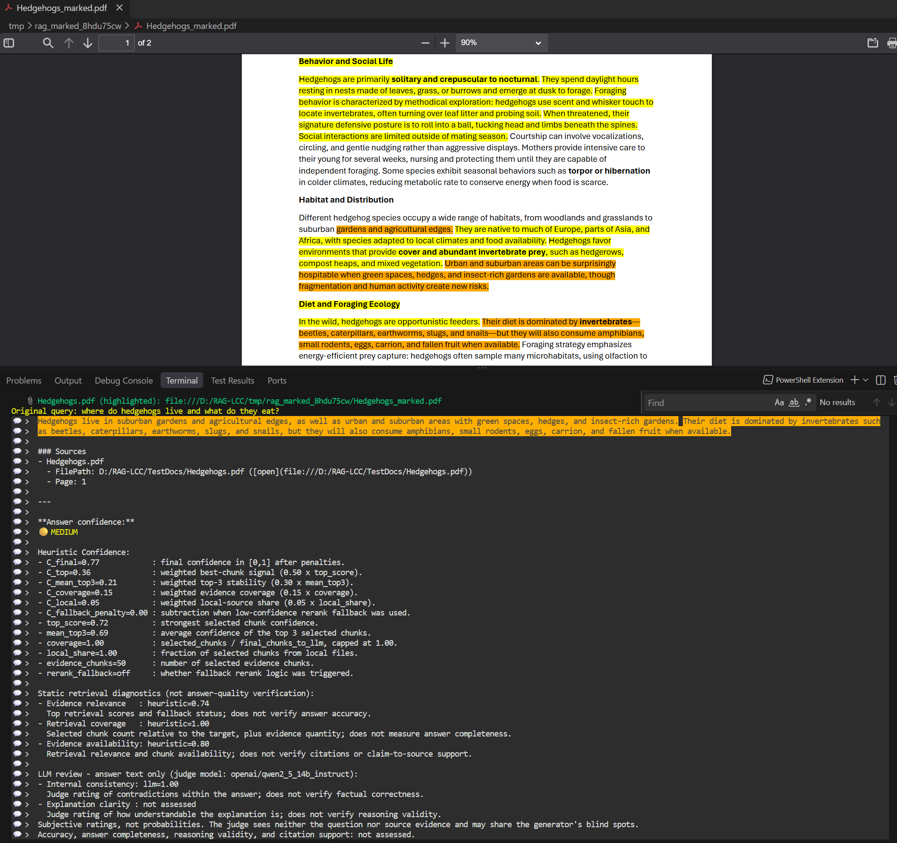
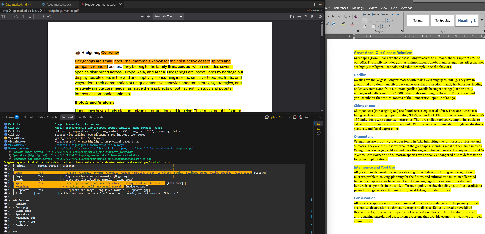
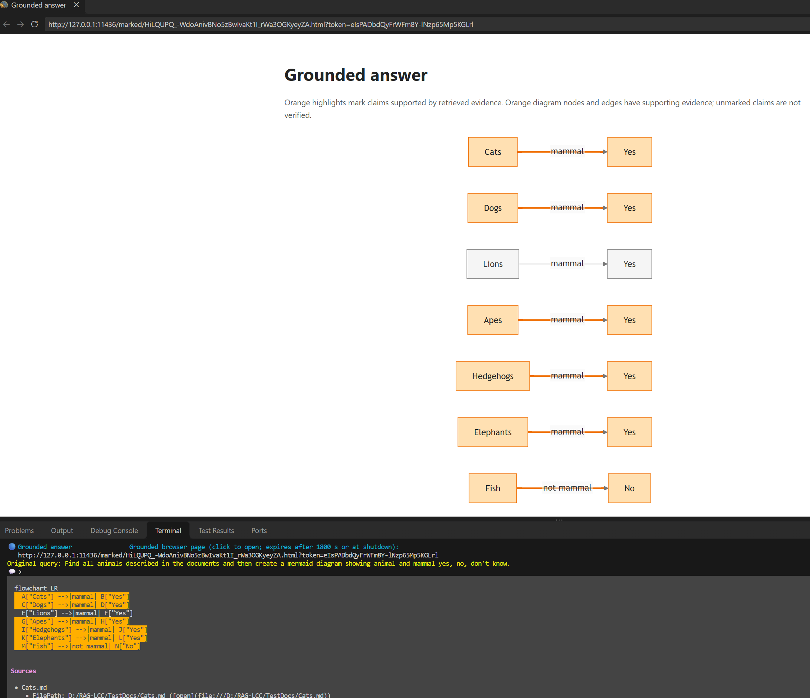
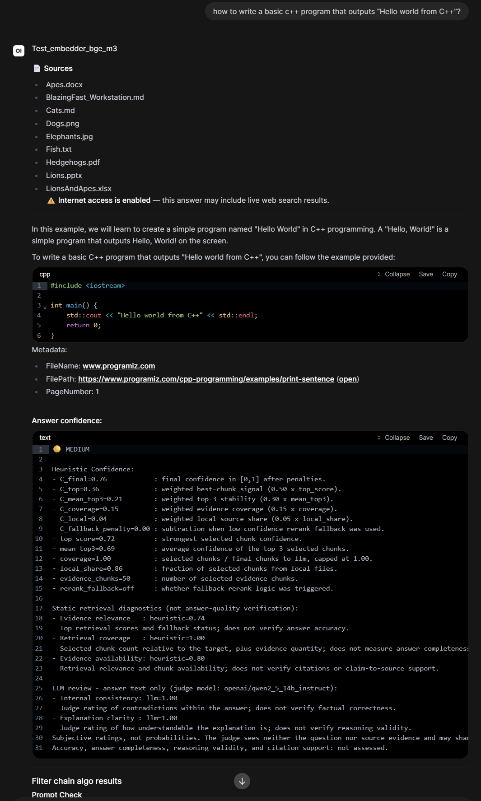
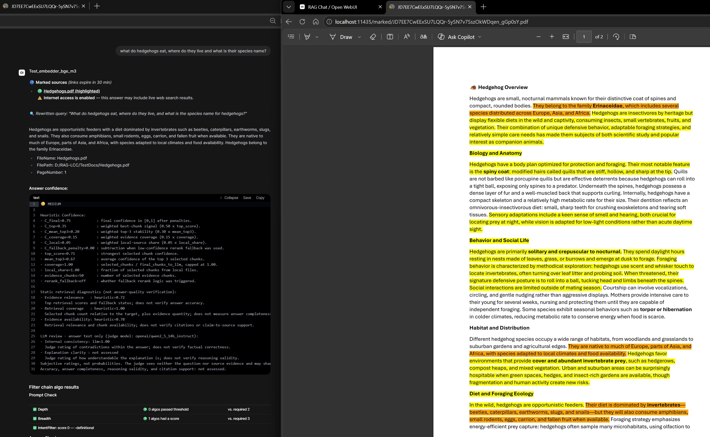

  

## Overview

Experimental Retrieval-Augmented Generation under constraints.

RAG-LCC is a practical lab for understanding where RAG systems fail and how to fix them: retrieval misses, context poisoning, multilingual drift, and compliance edge cases.

View or download the [PowerPoint presentation](https://github.com/HarinezumIgel/RAG-LCC/blob/main/Documentation/Presentations/RAG-LCC_Presentation.pptx), or watch it play below:

The presentation also highlights tabular answers, document summarization, and the optional web-retrieval leg.

## Who this is for

- Researchers and practitioners exploring *why* RAG pipelines succeed or fail
- Engineers working with **large, multilingual, or conflicting document sets**
- Teachers and students learning RAG internals through hands-on experimentation
- Anyone debugging **multi‑turn chat‑context failures** in RAG systems
- Users running RAG on **constrained or commodity hardware**
- People who want to experiment beyond "embed + cosine + top‑k"

Short: If you want to understand *why* your RAG fails, RAG-LCC gives you a playground to experiment with the parameters that matter. You can tune settings, compare alternatives on a small test corpus, and carry those insights back into your own RAG. In other words, RAG-LCC is an insight tool with reusable ideas, not an everyday production RAG.

## What you get

- [Hybrid retrieval pipeline](https://github.com/HarinezumIgel/RAG-LCC/blob/main/ARCHITECTURE.md#retrieval-chunk-selection) with Vector, BM25, Graph, and Regex retrieval
- [Multi-turn chat support](https://github.com/HarinezumIgel/RAG-LCC/blob/main/ARCHITECTURE.md#-chat-context) with [query rewriting and topic switching](https://github.com/HarinezumIgel/RAG-LCC/blob/main/ARCHITECTURE.md#query-rewrite-coreference-resolution)
- [Document summarization](https://github.com/HarinezumIgel/RAG-LCC/blob/main/HANDS_ON_TOUR.md#summarize-an-indexed-document) across all indexed chunks of a selected document
- Optional web retrieval to augment local results with live web content
- [Multi-query expansion](https://github.com/HarinezumIgel/RAG-LCC/blob/main/ARCHITECTURE.md#retrieval-chunk-selection) for better recall
- [Cross-encoder reranking and strategy-based context assembly](https://github.com/HarinezumIgel/RAG-LCC/blob/main/ARCHITECTURE.md#retrieval-chunk-selection)
- Configurable [orchestration flows](https://github.com/HarinezumIgel/RAG-LCC/blob/main/CONFIGURATION_REFERENCE.md#-orchestration-flows-config_orchestratorpy) for per-turn pipeline control
- [Confidence evaluation signals](https://github.com/HarinezumIgel/RAG-LCC/blob/main/ARCHITECTURE.md#confidence-evaluation-and-signals) for evidence-quality tuning
- Optional [answer-quality judge](https://github.com/HarinezumIgel/RAG-LCC/blob/main/CONFIGURATION_REFERENCE.md#retrieval-diagnostics-and-answer-text-review) with named-model output and aligned scores;
  flat CSV exports expose individual metrics and repeated pipeline steps
- [Compliance filtering](https://github.com/HarinezumIgel/RAG-LCC/blob/main/LEGAL.md) during ingestion, query, and answer phases
- [Grounding markers](https://github.com/HarinezumIgel/RAG-LCC/blob/main/ARCHITECTURE.md#-answer-grounding) to inspect matching evidence; overlap does not establish accuracy

## Application suite

Confidence logging, quality-scoring switches, and the judge prompt are centralized
in [Config_Confidence.py](https://github.com/HarinezumIgel/RAG-LCC/blob/main/src/Configuration/Config_Confidence.py). See the
[configuration reference](https://github.com/HarinezumIgel/RAG-LCC/blob/main/CONFIGURATION_REFERENCE.md#answer-quality-confidence)
for defaults, output sections, and the `CONFIDENCE_FLAT` CSV schema.

| Application | Purpose | Typical output |
| --- | --- | --- |
| DocClassify | Classify and compress corpus content before indexing | CSV metadata used for selective loading |
| RAGLoad | Ingest and index local documents into multiple retrievers | ChromaDB + BM25 + Graph + Regex indexes |
| RAGChat | Interactive CLI RAG with grounding and safety checks | Grounded multi-turn answers |
| RAGChatService | OpenAI-compatible API wrapper for RAGChat | API endpoint for OpenWebUI and clients |

For the **vLLM backend**, the companion project
[HarinezumIgel/harinezumigel-llm-stack](https://github.com/HarinezumIgel/harinezumigel-llm-stack)
provides configuration-driven orchestration for self-hosted LiteLLM and vLLM
deployments. Use it to serve the LLMs, embedder, and reranker required by RAG-LCC.

## Why this project is different

Most RAG stacks optimize only retrieval score. RAG-LCC also optimizes context quality.

- Detects contradictory or noisy context before generation
- Handles multilingual retrieval routing by language buckets
- Makes retrieval and grounding behavior observable with debug levels
- Exposes most architecture decisions through configuration

## Quick start

1. Read installation guide
  [INSTALL.md](https://github.com/HarinezumIgel/RAG-LCC/blob/main/INSTALL.md)
2. Load docs
   python ./src/Apps/RAGLoad.py --doc-dir TestDocs
3. Start chat
   python ./src/Apps/RAGChat.py --doc-dir TestDocs

## Query and grounding examples

- [QUERY_OUTPUT_EXAMPLE.md](https://github.com/HarinezumIgel/RAG-LCC/blob/main/QUERY_OUTPUT_EXAMPLE.md)
  Full CLI transcript of a real RAGChat run, including startup checks,
  retrieval settings, configurable orchestration decisions, rerank diagnostics,
  grounding, and confidence-evaluation output.

- [Gentle tuning showcase for dev.io](https://dev.to/harinezumigel/how-i-tune-rag-pipelines-with-rag-lcc-a-hands-on-local-guide-l8l)
  Beginner-friendly article that explains the RAG-LCC mental model,
  query-output reading, practical tuning paths across all four apps,
  plus an expert lane for orchestrator and query-rewrite tuning.
  Note: RAG-LCC is an experimental learning and tuning lab, not a production-ready deployment stack.

### CLI grounding example: hedgehog query

Shows sentence-level overlap markers in the CLI flow. These help inspect matching
evidence but do not verify that an answer is factually correct.

### Tabular answer with source grounding

A single query can retrieve information and request a table. This example shows an
animal classification table alongside highlighted passages in the source documents.
The highlights help inspect matching evidence; they do not establish answer accuracy.

### Mermaid diagram with grounding

Mermaid diagrams can be viewed by through the RAGChat in memory web server.

### OpenWebUI example (web)

Shows the same grounding concept through the OpenWebUI integration path
(`RAGChatService`). Useful for validating that API/UI output preserves
evidence links, not just CLI output; matching text is not proof of accuracy.

### OpenWebUI grounded example (local results)

This example shows an OpenWebUI answer with source attribution, including a web
result. Source links help inspect retrieved evidence but do not prove answer
accuracy.

## Documentation hub

- Project overview
  [README.md](https://github.com/HarinezumIgel/RAG-LCC/blob/main/README.md)
- Installation
  [INSTALL.md](https://github.com/HarinezumIgel/RAG-LCC/blob/main/INSTALL.md)
- Full configuration reference
  [CONFIGURATION_REFERENCE.md](https://github.com/HarinezumIgel/RAG-LCC/blob/main/CONFIGURATION_REFERENCE.md)
- Architecture deep dive
  [ARCHITECTURE.md](https://github.com/HarinezumIgel/RAG-LCC/blob/main/ARCHITECTURE.md)
- Query output walkthrough
  [QUERY_OUTPUT_EXAMPLE.md](https://github.com/HarinezumIgel/RAG-LCC/blob/main/QUERY_OUTPUT_EXAMPLE.md)
- Hands-on tour
  [HANDS_ON_TOUR.md](https://github.com/HarinezumIgel/RAG-LCC/blob/main/HANDS_ON_TOUR.md)
- Legal and compliance notes
  [LEGAL.md](https://github.com/HarinezumIgel/RAG-LCC/blob/main/LEGAL.md)

## Source repository

[HarinezumIgel/RAG-LCC](https://github.com/HarinezumIgel/RAG-LCC)

## ⭐ Support the Project

RAG-LCC is developed in personal time and continues to evolve through community interest, feedback, and experimentation.

If the project helped you, please consider:

- Starring the repository
- Sharing it with colleagues and friends
- Reporting issues and ideas

The RAG-LCC Experimental Lab runs on curiosity, feedback, and GPUs converting electricity into heat. Community interest is a major motivation for continued development.
